<p align="center">
  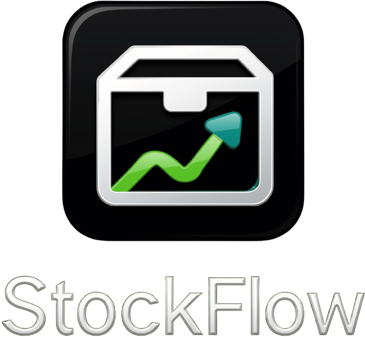
</p>

# StockFlow

[](https://github.com/OdirileMasemola/Stock-Flow/actions/workflows/ci.yml)

StockFlow is an Android inventory and business management app built for small retail businesses in South Africa. Shop owners can track stock, manage sales through a Point of Sale screen, and keep an eye on their business from their phone.

This README covers the final Portfolio of Evidence (Part 3) submission of the project. The latest release is [StockFlow v1.1.0](https://github.com/OdirileMasemola/Stock-Flow/releases/tag/v1.1.0).

---

## Main Features

### Authentication
- Registration and login
- Google Sign-In (SSO)
- Role-based access (Owner, Staff, Supplier)
- Employees management for shop owners

### Inventory
- Add, edit and delete products
- Product categories
- Stock levels
- Product images
- Barcode/QR scanning

### Sales and Purchasing
- Point of Sale
- Suppliers
- Purchase orders
- Low-stock monitoring with real-time push notifications
- Reports with best-selling and slow-moving products, plus PDF export
- Works offline: products, categories and sales sync when the connection returns

### Settings
- Profile management
- Business information
- Light/Dark/System theme
- English, isiZulu and Sesotho
- Account deletion and privacy policy

---

## Technology Used

| Area             | Technology                          |
| ---------------- | ------------------------------------ |
| Android          | Kotlin, XML, ViewBinding, Fragments |
| Architecture     | MVVM, Repository Pattern            |
| Networking       | Retrofit, OkHttp                    |
| Offline storage  | Room, WorkManager                   |
| Notifications    | Firebase Cloud Messaging            |
| Backend          | Ktor, Kotlin                        |
| Database         | PostgreSQL, Supabase                |
| Authentication   | JWT, BCrypt, Google Sign-In         |
| Barcode Scanning | CameraX, Google ML Kit              |
| CI/CD            | GitHub Actions                      |

---

## Release Notes

### Changes since the Part 2 prototype

- **Single sign-on with Google**: users can sign in or sign up with their Google account. The backend checks each Google ID token before issuing a StockFlow JWT.
- **Offline mode with Room sync**: product, category, supplier, purchase order and dashboard data is cached in Room. Product and category changes made offline are queued and synced by WorkManager when the device reconnects.
- **Offline sales (new in 1.1.0)**: POS sales recorded offline are checked against cached stock, deducted from local stock, shown as *Pending sync* in sales history and posted when back online. Each sale carries a client-generated ID, so a retry never records it twice.
- **Real-time notifications**: Firebase Cloud Messaging sends a low-stock push notification to the shop owner as soon as a sale takes a product below its minimum stock level.
- **isiZulu and Sesotho**: the whole UI is available in English, isiZulu and Sesotho, and the language can be changed in Settings.
- **Account deletion and privacy policy**: users can delete their account from Settings or through the public [account deletion page](https://stock-flow-trbq.onrender.com/account-deletion). The [privacy policy](https://stock-flow-trbq.onrender.com/privacy-policy) is hosted by the backend.
- **Release signing and Play Store preparation**: the package was renamed to `com.odirilemasemola.stockflow`, the app targets SDK 36 and release builds are signed with an upload key kept outside the repository.
- **Shop-level data isolation**: every product, sale, supplier and purchase order belongs to a shop, and the server checks the shop for every request.
- **Employees management (new in 1.1.0)**: shop owners can add staff by email, change their role (Staff or Supplier) and remove them. Staff then work in the owner's shop.
- **Best-selling and slow-moving products (new in 1.1.0)**: Reports ranks the top products by units sold and lists in-stock products with the fewest sales for the selected period. Both lists are included in the PDF export, and the last report per period is available offline.
- **Barcode scanning**: CameraX and ML Kit scan product barcodes and QR codes in Inventory and at the POS.
- **PDF export**: business reports can be exported as a PDF and shared.
- **Activity history and images**: important actions are recorded in a Firestore activity history, and product, profile and business images are stored in Supabase Storage.

### Innovative and user-defined features

These features go beyond the core brief and were defined by our group:

1. Offline-first POS, so a shop can keep selling during load-shedding or when mobile data runs out.
2. Real-time FCM low-stock alerts.
3. isiZulu and Sesotho localisation for South African shop owners and staff.
4. Barcode and QR scanning to find products quickly.
5. Best-selling and slow-moving product insights, with PDF export.
6. Employees management with owner-only role control.

---

## Design Considerations

- **Architecture**: the Android app uses MVVM. Activities and fragments observe ViewModels, ViewModels call repositories, and repositories combine Retrofit with the Room cache. The Ktor backend is split into routes, services and repositories (Exposed on PostgreSQL), so business rules stay in services that can be unit tested.
- **Offline-first**: screens read from Room first and refresh from the API when they can. Writes made offline go into a `pending_operations` queue that `PendingSyncWorker` replays in dependency order (categories, then products, then sales). The server stays authoritative: prices and totals are always recalculated on the server.
- **Security**: passwords are hashed with BCrypt, every protected endpoint needs a signed JWT, and Google ID tokens are verified on the server. `ShopAccessService` resolves the shop from the token rather than from the request body, and owner-only actions such as employees management return 403 for other roles. The JWT is stored in `EncryptedSharedPreferences`. Secrets, keystores and `google-services.json` are kept out of the repository.
- **UX and accessibility**: the screens share one Material design system with light and dark themes, consistent cards, empty, loading and error states, and an offline banner when cached data is shown. Actions on the newer screens, such as Employees, use 48dp touch targets and content descriptions for TalkBack.
- **Localisation**: every user-facing string lives in string resources with English, isiZulu (`values-zu`) and Sesotho (`values-st`) translations, so new features ship in all three languages.

---

## App Screenshots

### Onboarding

| | | |
|---|---|---|
| 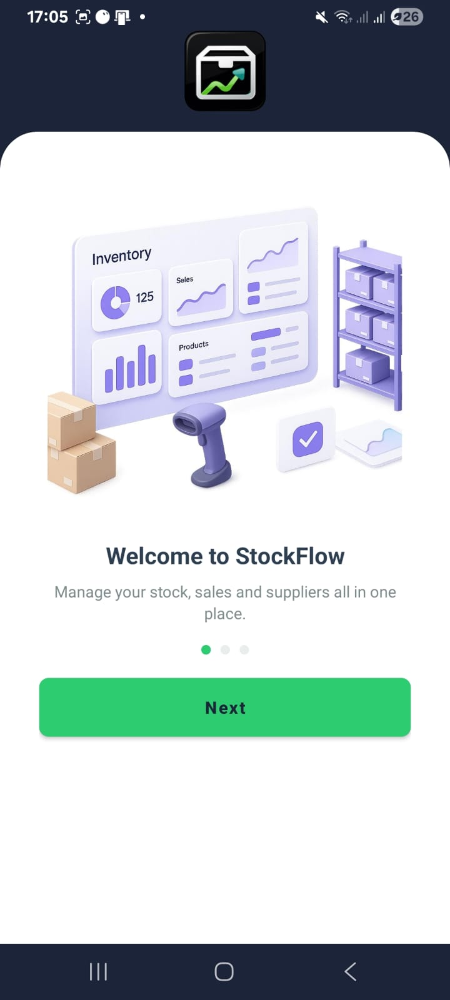 | 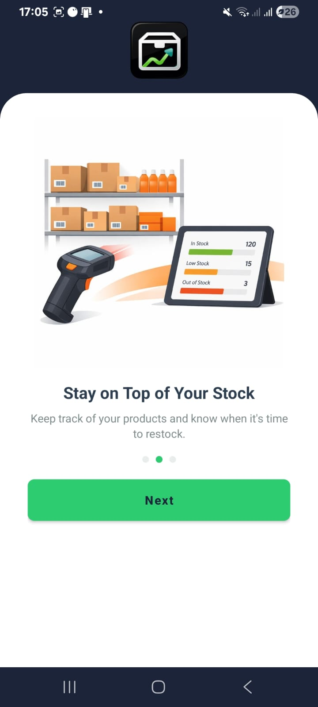 | 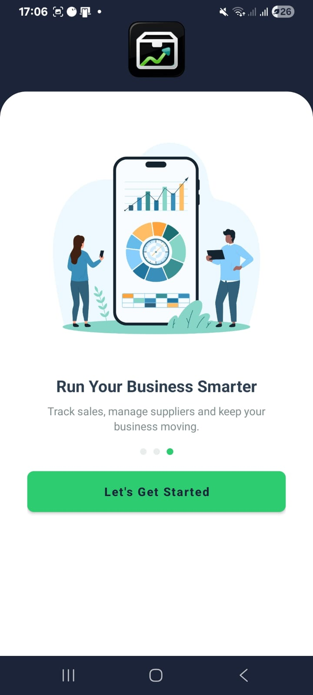  |

### Authentication

| Login | Register |
|---|---|
| 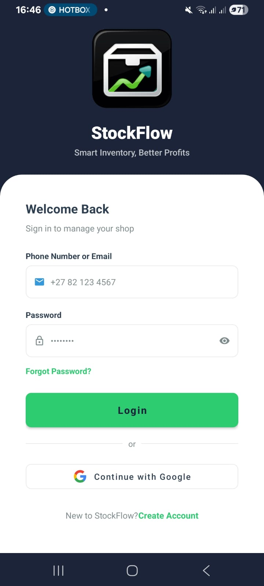 | 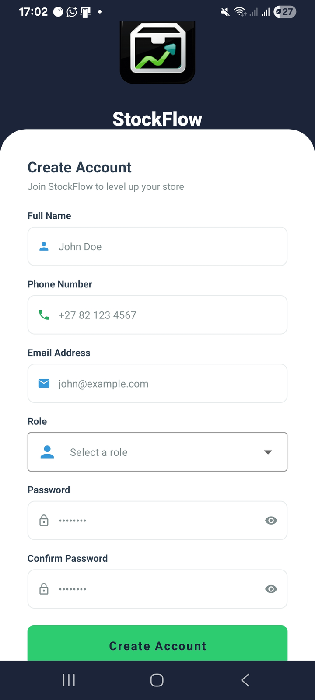 |

### Dashboard

| Dashboard |
|---|
| 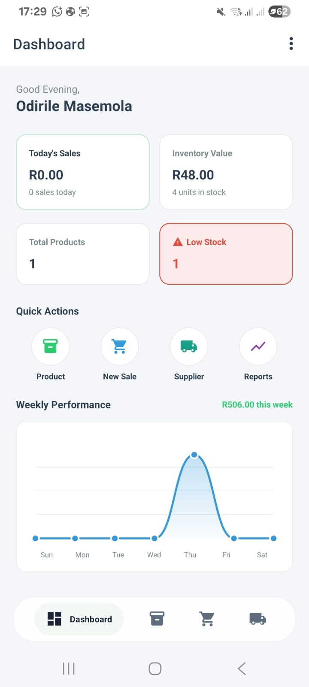 |

### Inventory

| Inventory | Add Product | Edit Product |
|---|---|---|
| 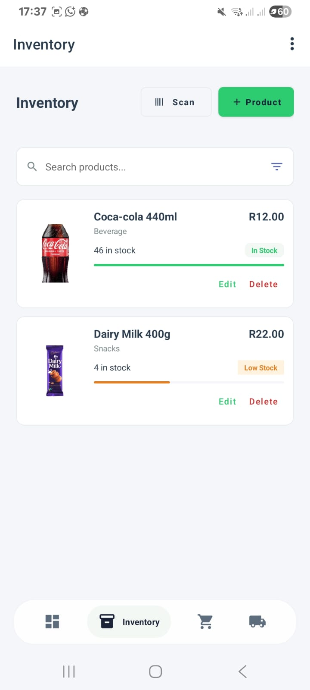 | 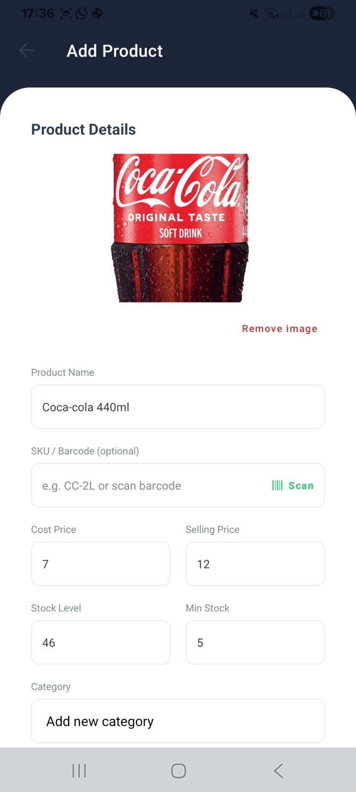 | 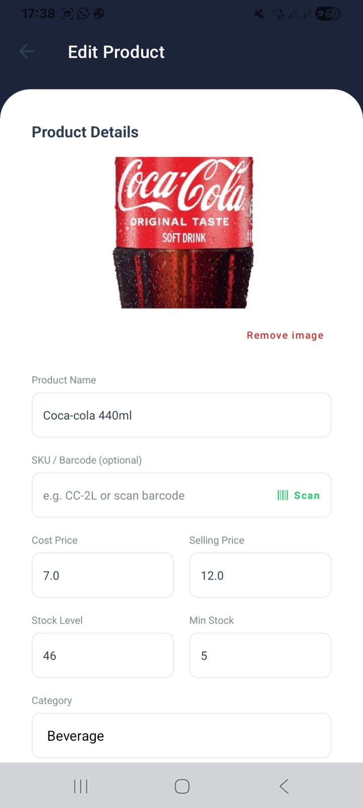 |

### Suppliers and Purchase Orders

| Suppliers | Purchase Orders | New Order |
|---|---|---|
| 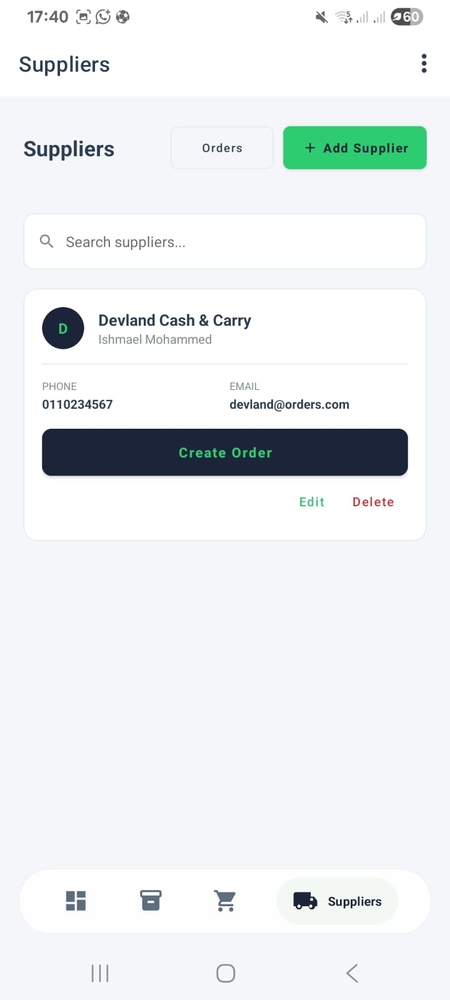 | 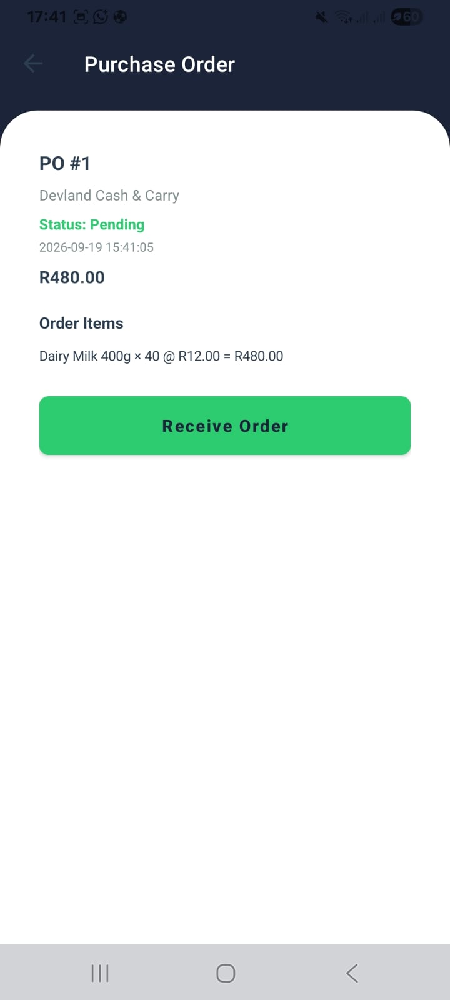 | 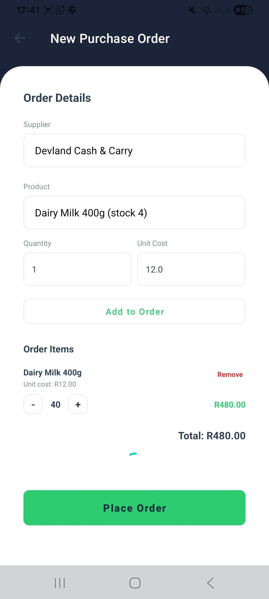 |

### Settings

| Settings |
|---|
| 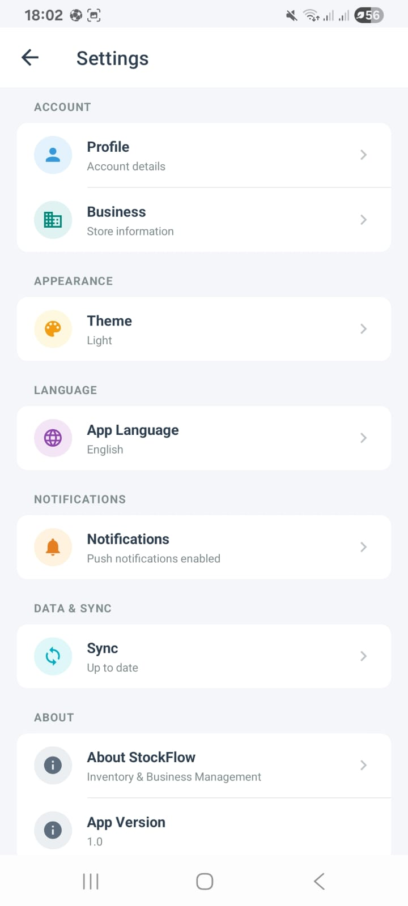 |

---

## System Architecture

```text
Android App
     ↓
Retrofit
     ↓
Ktor REST API
     ↓
PostgreSQL Database
```

<p align="center">
  
</p>

- Android handles the user interface.
- Ktor handles API requests and business logic.
- PostgreSQL stores application data.

---

## Database

The app uses PostgreSQL (hosted on Supabase) to store its data. Main tables:

- Users
- Roles
- Businesses
- Products
- Categories
- Suppliers
- Sales
- Sale Items
- Purchase Orders
- Purchase Order Items

---

## Authentication

- Email/password registration and login
- Passwords hashed with BCrypt
- JWT authentication for protected endpoints
- Google Sign-In

---

## GitHub and GitHub Actions

The project is hosted on GitHub, and every feature or fix is committed with a conventional-commit message so the history shows how the app was built. Releases with signed APKs are published on the [Releases page](https://github.com/OdirileMasemola/Stock-Flow/releases).

The CI workflow, [`.github/workflows/ci.yml`](.github/workflows/ci.yml), runs on every push and pull request to `master` and `final-poe`. It has two jobs:

- **Backend build and test**: sets up JDK 21, starts a disposable PostgreSQL 17 service container, then runs `./gradlew :backend:build`. This compiles the Ktor backend, runs the unit and route tests (including the PostgreSQL migration tests) and packages the server.
- **Android unit tests and debug build**: sets up JDK 21 and the Android SDK (platform 36, build-tools 36.0.0), runs `./gradlew :app:testDebugUnitTest` (Robolectric, Room and sync tests) and then `./gradlew :app:assembleDebug`.

If a job fails, its test reports are uploaded as build artifacts. The badge at the top of this README shows the latest result on `master`.

---

## Demo Video

The demo video shows the app running on a physical device, with a voice-over explaining each feature.

Video link: (to be added)

---

## Privacy and Account Deletion

- Privacy policy: https://stock-flow-trbq.onrender.com/privacy-policy
- Account deletion: https://stock-flow-trbq.onrender.com/account-deletion

---

## Project Structure

```text
StockFlow/
├── app/       # Android application
├── backend/   # Ktor REST API
├── docs/      # Documentation and screenshots
└── gradle/    # Gradle configuration
```

---

## Getting Started

### Requirements
- Android Studio (Ladybug or newer)
- JDK 21
- PostgreSQL / Supabase account

### 1. Clone the repository

```bash
git clone https://github.com/OdirileMasemola/Stock-Flow.git
cd Stock-Flow
```

### 2. Backend setup

Create a `.env.local` file in the `backend` directory with:

```env
DB_URL=jdbc:postgresql://your-db-host:5432/postgres
DB_USER=your-user
DB_PASSWORD=your-password
JWT_SECRET=your-secure-secret
```

Run the backend:

```bash
./gradlew :backend:run
```

### 3. Android setup

1. Open the project in Android Studio.
2. Sync Gradle.
3. Run the `app` module on an emulator or physical device.

---

## Group Members

| Student Number | Name             |
| --------------- | ---------------- |
| S10104238       | Lerato Mokoena   |
| ST10441421      | Odirile Masemola |
| ST10450294      | Ripfumelo Mabasa |
| ST10168130      | Sisipho Njili    |

---

## License

This project is licensed under the **MIT License** — see the [LICENSE](LICENSE) file for details.
